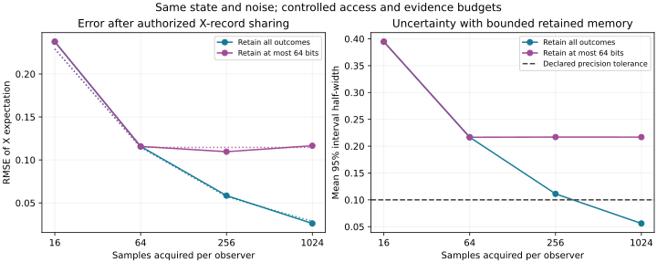

# ∴ ⋈ — observer-access experiment

Source: [96986cb](https://github.com/rookslackie/-.Termux.Runtime.Kernel.v-./tree/96986cb85b9def64a154ae88397c590d25ae41be). [Complete results](results.json), SHA-256 `da2df3a2fe3597e06ef8a0888ebc36ed8a2b2e9fdfc193526e7dc548fc57c586`.

The same preparation and noise model were sampled through X- and Z-access contracts. The Z-only observer retained a null X estimate until an explicit local grant shared X records. Its subsequent estimate and interval matched the sender's retained evidence exactly.

Configuration: φ = π/3, independent Z probability 0.1, seed 20261020, 256 repetitions per budget, nominal 95% Wilson intervals, expectation half-width tolerance 0.1. The evaluator's independent density reference gives E[X] = 0.4 and E[Z] ≈ 0. Preparation, noise parameters and reference values are withheld from the observer APIs.

| Sample budget per observer | Retained X bits | Observed RMSE | Analytical RMSE | Mean interval half-width | Precision resolved / repetitions | Coverage / repetitions |
|---:|---:|---:|---:|---:|---:|---:|
| 16 | 16 | 0.237536 | 0.229129 | 0.394638 | 0 / 256 | 240 / 256 |
| 64 | 64 | 0.115711 | 0.114564 | 0.216658 | 0 / 256 | 243 / 256 |
| 256 | 256 | 0.058511 | 0.057282 | 0.111146 | 0 / 256 | 238 / 256 |
| 1024 | 1024 | 0.026103 | 0.028641 | 0.056014 | 256 / 256 | 248 / 256 |
| 16 | 16 | 0.237536 | 0.229129 | 0.394638 | 0 / 256 | 240 / 256 |
| 64 | 64 | 0.115711 | 0.114564 | 0.216658 | 0 / 256 | 243 / 256 |
| 256 | 64 | 0.109592 | 0.114564 | 0.216978 | 0 / 256 | 246 / 256 |
| 1024 | 64 | 0.116516 | 0.114564 | 0.216928 | 0 / 256 | 234 / 256 |

The first four rows retain all outcomes; the final four cap retained outcome memory at 64 bits. The two arms use the same outcome streams. Sample budgets use nested prefixes; these are paired comparisons. Raw sampling calls are counted once per shared pool, not once per displayed budget.

A Z-only view left X unidentified in every repetition at every budget, with range [−1,1]. Its absence of a point prediction is retained as null rather than scored as a zero estimate. The memory cap limits retained X evidence even when additional samples are acquired. The analytical RMSE comparison is sqrt((1−μ²)/n), where n is the number of retained independent outcomes. The estimator and its observed error use actual sparse-vector witnesses, not that formula.

Coverage is the fraction of 256 repeated intervals containing the evaluator reference. Nominal 95% intervals do not guarantee coverage in every finite batch or simultaneous coverage across the sweep. The JSON includes Wilson intervals for the observed coverage fractions. Precision resolution is a width criterion, not an assertion that every resolved estimate is correct.



Solid error curves show observed RMSE; dotted curves show the analytical RMSE comparison. The Z-only view remains unidentified before sharing and is not assigned a numerical prediction error.

## Transfer and recovery

Node A committed the first benchmark; node B restored 1 result and executed 2 remaining steps. The encrypted checkpoint contained 73,010 bytes. Both causal ledgers verified. Restart replay executed zero completed steps and retained the receiver head hash:

`9fdde92162e2d5557174f3037dbec2191495935f8ddcc167e07494e5fc0ddc3e`

The recovered StructuralKernel QR payload also completed an exact GlyphSafe / ThinkSync round trip: **135 bytes**, SHA-256 `b0769554d36cd87a110ed7892cc622e5ab00f39ad01ea7d6ab71df69a9a00dc7`. Its original dialect is retained as source; receipt processing supplies no execution grant. [Recovered contracts and QR decoder receipt](../../recovered/2026-10-20/README.md) preserve the FullStack / FullCycle lineage, historical SHA3 declaration and legitimate null operator.

## Costs and scope

The two arms executed 1,048,576 freshly prepared simulated qubits and the same number of projective witnesses. Source execution used 32.413 wall seconds, 32.664 CPU seconds and 49.72 MiB process peak RSS, including transfer and restart verification. Host timing and process RSS are separate from the model's retained-outcome-bit budget. This is one trusted-process statistical observer model and ideal simulated noise experiment. ORT's full recursive-coherence formula, presence thresholds, Lorentz propagation and physical-collapse claims retain separate source meanings and testing requirements.

## Reproduce

```bash
git checkout 96986cb85b9def64a154ae88397c590d25ae41be
python -m pip install -r requirements.txt -r requirements-ci.lock
python -m pytest -v
python benchmarks/verify_observer.py --home .xi/observer-check --output .xi/observer-check.json
```

A fresh home creates fresh keys, packet randomness and capsule timestamps. Seeded sampling, observer estimates and evidence digests reproduce. Reuse the same home to verify zero repeated computation and unchanged ledger heads.

[Ledger manifest](ledgers.json) and the compressed [node A](node-a.sqlite3.gz) / [node B](node-b.sqlite3.gz) snapshots retain exact sources and causal computation evidence. Exports exclude identity seeds and clear local transport tables. Inspect using `WorldKernel.verify` at the source version above; replay with the exact source and local execution grant. The QR source remains recoverable by its digest without an executable operator mapping.

Method references: [IBM Pauli measurements and tomography](https://learning.quantum.ibm.com/course/general-formulation-of-quantum-information/general-measurements), [NIST Wilson intervals](https://www.itl.nist.gov/div898/handbook/prc/section2/prc241.htm). [Experiment contract and commands](../../OBSERVER_EXPERIMENT.md).

[GitHub Actions verification](https://github.com/rookslackie/-.Termux.Runtime.Kernel.v-./actions/runs/39395239951).
