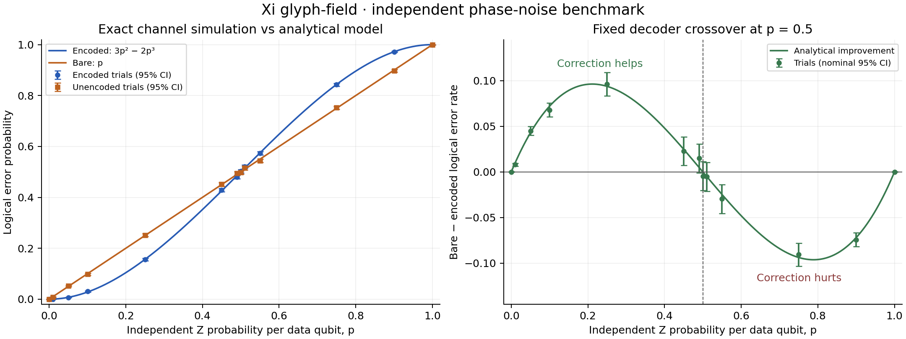

# Xi glyph-field independent phase-noise benchmark

Run `b4c36c933eb86c87fbd6` uses **20,000 trials per arm per probability**, **13 probabilities**, **520,000 simulated trials**, and master seed **20261018**.

The fixed minimum-weight phase-flip repetition code improves channel reliability for **0 < p < 0.5**, worsens it for **0.5 < p < 1**, and ties the bare channel at **p = 0, 0.5, 1** under this one-round independent-Z model. The analytical statement is exact; the Monte Carlo estimates below have finite-sample uncertainty.

The conservative nominal 95% difference intervals resolve improvement at p = 0.01, 0.05, 0.1, 0.25, 0.45; worsening at p = 0.55, 0.75, 0.9. They do not resolve a difference at p = 0, 0.49, 0.5, 0.51, 1. Failure to resolve a difference does not establish equality.

## Observed logical error rates

Intervals are marginal 95% Wilson score intervals. They describe sampling uncertainty within this simulated model, not model error or hardware uncertainty. The collection of rate intervals is not a simultaneous 95% band.

| Physical Z probability p | Encoded failures / n | Encoded rate [95% CI] | 3p² − 2p³ | Bare failures / n | Bare rate [95% CI] | Observed comparison |
|---:|---:|---:|---:|---:|---:|:---|
| 0 | 0 / 20,000 | 0.000000 [0.000000, 0.000192] | 0.000000 | 0 / 20,000 | 0.000000 [0.000000, 0.000192] | not resolved at this sample count |
| 0.01 | 6 / 20,000 | 0.000300 [0.000137, 0.000654] | 0.000298 | 165 / 20,000 | 0.008250 [0.007087, 0.009601] | improves |
| 0.05 | 132 / 20,000 | 0.006600 [0.005569, 0.007821] | 0.007250 | 1,031 / 20,000 | 0.051550 [0.048571, 0.054701] | improves |
| 0.1 | 604 / 20,000 | 0.030200 [0.027917, 0.032664] | 0.028000 | 1,962 / 20,000 | 0.098100 [0.094054, 0.102300] | improves |
| 0.25 | 3,115 / 20,000 | 0.155750 [0.150791, 0.160842] | 0.156250 | 5,039 / 20,000 | 0.251950 [0.245981, 0.258014] | improves |
| 0.45 | 8,572 / 20,000 | 0.428600 [0.421756, 0.435472] | 0.425250 | 9,027 / 20,000 | 0.451350 [0.444463, 0.458255] | improves |
| 0.49 | 9,604 / 20,000 | 0.480200 [0.473280, 0.487127] | 0.485002 | 9,901 / 20,000 | 0.495050 [0.488122, 0.501979] | not resolved at this sample count |
| 0.5 | 10,054 / 20,000 | 0.502700 [0.495771, 0.509628] | 0.500000 | 9,962 / 20,000 | 0.498100 [0.491172, 0.505029] | not resolved at this sample count |
| 0.51 | 10,412 / 20,000 | 0.520600 [0.513673, 0.527519] | 0.514998 | 10,308 / 20,000 | 0.515400 [0.508471, 0.522323] | not resolved at this sample count |
| 0.55 | 11,463 / 20,000 | 0.573150 [0.566282, 0.579990] | 0.574750 | 10,870 / 20,000 | 0.543500 [0.536589, 0.550394] | worsens |
| 0.75 | 16,850 / 20,000 | 0.842500 [0.837386, 0.847483] | 0.843750 | 15,040 / 20,000 | 0.752000 [0.745967, 0.757936] | worsens |
| 0.9 | 19,436 / 20,000 | 0.971800 [0.969414, 0.974005] | 0.972000 | 17,952 / 20,000 | 0.897600 [0.893322, 0.901726] | worsens |
| 1 | 20,000 / 20,000 | 1.000000 [0.999808, 1.000000] | 1.000000 | 20,000 / 20,000 | 1.000000 [0.999808, 1.000000] | not resolved at this sample count |



The encoded analytical prediction falls inside 13/13 marginal 95% intervals; the bare prediction falls inside 12/13. 95% intervals are not expected to cover every realized rate. The tests use fixed seeds and six-sigma sampling tolerances rather than requiring every 95% interval to contain its prediction.

## What is being measured

The data code uses stabilizers X0X1 and X1X2. Encoding applies two CNOTs from data qubit 0 into |00> ancillas, then H on all three data qubits. The decoder selects zero or one Z operation from the measured syndrome. Every shot actually executes noise sampling, both projective stabilizer measurements, correction, and decoding through `apply_operator`. The analytical expression is never used to classify a shot.

An additional noiseless reference qubit is entangled with the input. Its decoded Bell-state overlap measures **entanglement fidelity**, which is 1 for the identity channel and 0 for a nontrivial logical Pauli. Logical error rate is the observed fraction of these Bell-reference failures. Encoded runs contain three data qubits plus one reference; bare runs contain one data qubit plus one reference. Noise targets data qubits only. Preparation, encoding, stabilizer readout, recovery and decoding are ideal. The two arms use separate random streams at the same physical p.

The residual operator after an uncorrectable encoded pattern is logical **X**; the bare channel applies **Z**. Exhaustive exact-vector execution on the original T-state verifies fidelity 1 for correctable masks and 0.5 for uncorrectable masks. The T-state column below weights those eight simulated conditional fidelities by the observed mask counts. It is not a separate Monte Carlo run on T-state inputs.

| p | Encoded entanglement fidelity | Bare entanglement fidelity | Encoded T-state fidelity | Bare T-state fidelity |
|---:|---:|---:|---:|---:|
| 0 | 1.000000 | 1.000000 | 1.000000 | 1.000000 |
| 0.01 | 0.999700 | 0.991750 | 0.999850 | 0.991750 |
| 0.05 | 0.993400 | 0.948450 | 0.996700 | 0.948450 |
| 0.1 | 0.969800 | 0.901900 | 0.984900 | 0.901900 |
| 0.25 | 0.844250 | 0.748050 | 0.922125 | 0.748050 |
| 0.45 | 0.571400 | 0.548650 | 0.785700 | 0.548650 |
| 0.49 | 0.519800 | 0.504950 | 0.759900 | 0.504950 |
| 0.5 | 0.497300 | 0.501900 | 0.748650 | 0.501900 |
| 0.51 | 0.479400 | 0.484600 | 0.739700 | 0.484600 |
| 0.55 | 0.426850 | 0.456500 | 0.713425 | 0.456500 |
| 0.75 | 0.157500 | 0.248000 | 0.578750 | 0.248000 |
| 0.9 | 0.028200 | 0.102400 | 0.514100 | 0.102400 |
| 1 | 0.000000 | 0.000000 | 0.500000 | 0.000000 |

The corresponding ensemble T-state fidelities are 1 − q/2 and 1 − p, while channel entanglement fidelities are 1 − q and 1 − p. The T-state can therefore look better even when encoded channel reliability is worse. The crossover claim uses logical error rates and channel fidelity, not that state-specific overlap. Fidelity confidence intervals are recorded in the JSON as monotone transformations of the failure-rate Wilson intervals.

## Analytical benchmark and exhaustive audit

With independent Bernoulli(p) faults, two or three faults leave Z0Z1Z2 after minimum-weight correction. The inverse encoder maps this residual to X on the logical input, returning both recovery registers to |00>. Thus

```math
q = P_L = 3p^2(1-p) + p^3 = 3p^2 - 2p^3,
p-q = p(1-p)(1-2p).
```

The decoder stays fixed for the entire sweep, including p > 0.5. A decoder that knows errors are more probable than no error could choose different recovery representatives there; that is a different experiment.

All eight fault masks are explicitly simulated on Bell and T inputs:

| Mask (q0 q1 q2) | Measured syndrome | Corrected qubit | Decoded Pauli | Entanglement fidelity | T-state fidelity |
|:---|:---|:---|:---|---:|---:|
| 000 | [1, 1] | None | I | 1 | 1 |
| 001 | [1, -1] | 2 | I | 1 | 1 |
| 010 | [-1, -1] | 1 | I | 1 | 1 |
| 011 | [-1, 1] | 0 | X | 0 | 0.5 |
| 100 | [-1, 1] | 0 | I | 1 | 1 |
| 101 | [-1, -1] | 1 | X | 0 | 0.5 |
| 110 | [1, -1] | 2 | X | 0 | 0.5 |
| 111 | [1, 1] | None | X | 0 | 0.5 |

## Execution costs

Python: `3.12.14 (main, Aug 25 2026, 14:00:49) [Clang 22.1.3 ]`. Host: `Linux-6.18.55-x86_64-with-glibc2.39`.

| Measured quantity | Encoded arm | Bare arm |
|:---|---:|---:|
| Wall seconds for shot loops | 46.211 | 3.967 |
| CPU seconds for shot loops | 46.207 | 3.966 |
| Operator calls | 1,040,000 | 260,000 |
| Maximum sparse branches | 16 | 2 |
| Data qubits + noiseless reference | 3 + 1 | 1 + 1 |

Total simulation: 50.184 wall seconds and 50.179 CPU seconds. Process peak resident memory: 18.00 MiB. The encoded loop took 11.65× the bare loop wall time on this host.

Per-arm loops reuse noiseless prepared templates and exclude SQLite. Measurements include seed derivation, state copying/canonicalization, sampling, decoder execution and fidelity classification. Templates and exhaustive-mask checks are included in the total simulation cost. RSS is a process-wide high-water mark. These are host software costs, not gate durations, physical energy costs, or hardware performance.

The separate persistence pass committed 52 trial traces (2 per arm per probability), 416 total capsules, in 1.975 seconds; the SQLite file is 1,347,584 bytes. Every trace reopened SQLite after noise injection and verified its causal hash chain. Aggregate shots run in memory; only the explicitly listed traces were persisted. Set `--ledger-trials` equal to `--shots` to persist every transition for every sampled shot, at additional storage and runtime cost.

## Reproduce

From the repository root:

```bash
git checkout a3bc060d8d4dad44973a45be5adc4aa85b5042f4
python -m venv /tmp/xi-noise-venv
/tmp/xi-noise-venv/bin/python -m pip install -r requirements.txt -r requirements-ci.lock
/tmp/xi-noise-venv/bin/python -m xi_field.noise_benchmark --shots 20000 --seed 20261018 \
  --ledger-trials 2 --db benchmarks/phase-noise/ledger.sqlite3 --output benchmarks/phase-noise/results.json
/tmp/xi-noise-venv/bin/python -m pytest -v
```

For an existing Python environment, the benchmark itself uses only the standard library and the existing local Xi modules. The locked dependencies are needed for the full repository checks and HTTP interface.

Run the same command twice to replay the same SQLite worlds. Counts, mask histograms, fidelities, configuration ID, capsule count and existing head hashes must match. Wall/CPU/memory costs can differ. A fresh SQLite database has new creation timestamps and therefore different event hashes; its scientific results and event counts still reproduce. The master seed is expanded with SHA-256 over schema, master seed, float.hex(p), shot index and stream name; the first 16 digest bytes become a big-endian seed. Each sample uses Python Random/MT19937 and one `random() < p` draw per listed data qubit. Encoded noise, bare noise and syndrome streams are domain-separated; rate-list ordering does not change a point.

To render this report again (optionally install matplotlib for the PNG):

```bash
python benchmarks/render_phase_noise.py benchmarks/phase-noise/results.json --plot
```

## Sources and validation

- [Benchmark implementation](https://github.com/rookslackie/-.Termux.Runtime.Kernel.v-./blob/a3bc060d8d4dad44973a45be5adc4aa85b5042f4/xi_field/noise_benchmark.py)
- [Noise and QEC operators](https://github.com/rookslackie/-.Termux.Runtime.Kernel.v-./blob/a3bc060d8d4dad44973a45be5adc4aa85b5042f4/xi_field/operators.py)
- [Reproducible benchmark tests](https://github.com/rookslackie/-.Termux.Runtime.Kernel.v-./blob/a3bc060d8d4dad44973a45be5adc4aa85b5042f4/tests/test_xi_noise_benchmark.py)
- [CI workflow](https://github.com/rookslackie/-.Termux.Runtime.Kernel.v-./blob/a3bc060d8d4dad44973a45be5adc4aa85b5042f4/.github/workflows/python-package-conda.yml)
- [Full machine-readable results](results.json), including all sample counts, seeds, intervals, source hashes and trace receipts.
- [SQLite trace ledger (gzip)](ledger.sqlite3.gz). Extract with `gzip -dk benchmarks/phase-noise/ledger.sqlite3.gz` to inspect or replay the retained ledger.
- Results SHA-256: `3d2c49e864193d9994f6cf3edac942be7671467b3e7a16700c92ae21262c3725`.
- Source commit: `a3bc060d8d4dad44973a45be5adc4aa85b5042f4`; source files dirty at execution: `False`.
- [GitHub Actions validation](https://github.com/rookslackie/-.Termux.Runtime.Kernel.v-./actions/runs/39146122190).

The regression suite retains single-fault recovery at every qubit, the original T-state demonstration, restart persistence, idempotent replay, world invariants and symbolic capsule behavior. New tests cover all masks, Z composition by parity, seeded zero/single/multiple sampling, invalid-input rollback, stale-syndrome prevention, fixed seed outcomes, mask independence, analytical rates, confidence intervals, and interrupted/repeated SQLite benchmark runs. CI also runs a smaller seeded benchmark twice and uploads its JSON and SQLite ledger.

This is a development reference for The Field Ξ.QuantumCompute under a defined simulated noise model. The next useful extensions are independently controlled gate/readout faults and repeated correction rounds, so their contributions can be measured separately from these ideal operations. No physical-device conclusion is inferred from this experiment.

The complete 520,000-trial run was repeated: all scientific metrics and all 52 retained SQLite trace heads and counts matched exactly. The [verification receipt](verification.json) records checksums, local checks, the successful source-commit CI run and its benchmark artifact.
